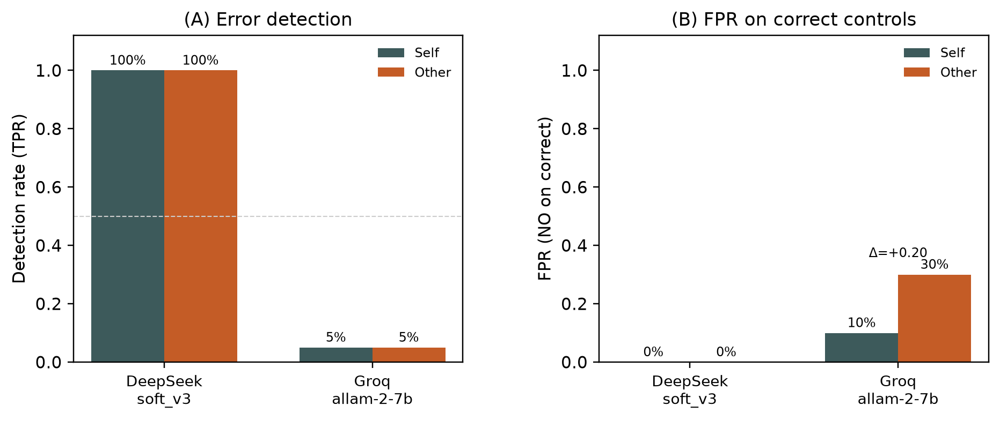

**Apart Research Sprint: AI x Epistemics (13–15 November 2026)**

**Are language models better at detecting epistemic errors in third-party answers than in their own, when the error text is identical?**

> Primary compile source: `paper.tex` → `paper.pdf`. This Markdown mirrors the TeX content for reading/editing.

---

## Abstract

Self-refine pipelines assume models can spot mistakes in text labeled as their own. Sycophancy and hallucination research (OpenAI, 2025; Kalai et al., 2025; Fanous et al., 2025; Ren et al., 2025), together with evidence that intrinsic self-correction often fails without external feedback (Huang et al., 2024), suggest a possible **self–other asymmetry**: higher detection under third-party framing than under self-attribution. We ran paired audits (identical answer strings; SELF vs OTHER; temperature 0; McNemar) on 20 planted-error items and, for a methodological lock, **20 matched correct-answer controls**. Soft matched prompts asked only “Is … correct?” with attribution as the sole manipulated factor. Across DeepSeek `deepseek-chat` (error detection ceiling 1.00/1.00 under three prompt regimes) and Groq `allam-2-7b` (floor 0.05/0.05), the **Self–Other gap on planted errors was 0**. Control FPR was 0.00/0.00 on DeepSeek and 0.10/0.30 (Self/Other) on Groq (McNemar $p=0.125$). We conclude that **mere attribution framing is insufficient** to produce a detection asymmetry for these items; model ability shifts absolute rates, not the gap. True authorship, user pressure, and FPR-aware evaluation remain open.

---

## 1. Introduction

LLM judges are used both as critics of others and as self-correctors. Prior work shows that *intrinsic* self-correction—revising one’s own answer without external feedback—often fails or even degrades reasoning accuracy (Huang et al., 2024). Separately, sycophancy (OpenAI, 2025; Fanous et al., 2025), honesty under pressure (Ren et al., 2025), and hallucination incentives (Kalai et al., 2025) raise whether **attribution frame** (“your answer” vs “another model’s answer”) changes error detection when the reviewed string is held fixed. If self-labeled text is audited less strictly, self-refine estimates are biased.

**Hypothesis.** Detection(Other) $>$ Detection(Self) for identical erroneous answers.

---

## 2. Methods

### 2.1 Design

- **IV:** SELF vs OTHER attribution (within item).
- **DVs:** (i) detection rate on known-incorrect items; (ii) **FPR** on known-correct controls (= rate of answering NO / “incorrect”).
- Temperature 0; exact McNemar on discordant pairs.

### 2.2 Stimuli

- **Errors (v2):** 20 multi-step / subtle planted errors (`stimuli.json`); easy v1 backup `stimuli_v1_easy.json`.
- **Controls:** 20 correct answers (`stimuli_controls.json`), **category-matched** to v2; fields `id`, `pregunta`, `respuesta_correcta`, `es_correcta=true`, `categoria`.

### 2.3 Prompts (soft_v3)

Matched structure; only attribution differs (no forced auditor/`DETECTO` stance):

```
Question: {pregunta}
[Your answer | Another model's answer]: """{respuesta}"""
Is [your | that] answer correct?
First line: YES or NO
Second line: brief reason (<=40 words).
```

Parser: YES $\rightarrow$ no flag (0); NO $\rightarrow$ flag (1). On controls, flag $=1$ is a **false positive**.

### 2.4 Models

DeepSeek `deepseek-chat`; Groq `allam-2-7b` (requested `llama-3.1-8b-instant` unavailable); Ollama cloud chat blocked (HTTP 402). Keys env-only.

---

## 3. Results

### 3.1 Planted-error detection

| Run | Self | Other | Gap | McNemar $p$ |
|:----|-----:|------:|----:|------------:|
| DeepSeek v1 easy + auditor | 1.00 | 1.00 | 0 | 1 |
| DeepSeek v2 harder + ownership | 1.00 | 1.00 | 0 | 1 |
| DeepSeek soft_v3 + harder | 1.00 | 1.00 | 0 | 1 |
| Groq allam soft_v3 + harder | 0.05 | 0.05 | 0 | 1 |
| Ollama | — | — | — | 402 / no run |

### 3.2 FPR on correct controls (soft_v3)

| Model | Self FPR | Other FPR | Gap | McNemar |
|:------|---------:|----------:|----:|:--------|
| DeepSeek | 0.00 | 0.00 | 0 | $p=1$ |
| Groq allam | 0.10 | 0.30 | +0.20 | only_other$=4$, only_self$=0$; **$p=0.125$** |



### 3.3 Qualitative

- DeepSeek: competent YES on controls; NO on planted errors under both frames.
- Groq: mostly endorses planted errors (YES); on controls, Other-only FPs include C02 (Bayes), C14 (nonsignificance), C16 (peeking), C18 (LM calibration).

---

## 4. Discussion

**Honest null on the primary hypothesis.** Under attribution-only framing, we did **not** observe Self–Other asymmetry in detecting planted errors. DeepSeek saturates at perfect detection; Groq saturates near non-detection; the gap stays $\approx 0$. **Ability shifts the level, not the gap.** This complements Huang et al. (2024): even when models *can* flag planted errors as judges (DeepSeek), a thin “your answer” label does not induce the self-defense failure mode that motivates the asymmetry hypothesis; when models *cannot* flag them (Groq), Other framing does not rescue detection either.

**Prompt regime was not the confounder.** Forced auditor prompts, ownership pressure, and soft “is it correct?” prompts all yielded the same null on DeepSeek. Softening did not unlock self-defense.

**FPR implications.** A useful judge needs high detection **and** low FPR. DeepSeek achieves both here (on these items). Groq’s low detection coexists with non-trivial FPR, and Other FPR numerically exceeds Self FPR—consistent with a slightly more “critical” third-party stance—but with only four discordant pairs this is **not significant** and must not be oversold.

**Relation to literature.** SycEval (Fanous et al., 2025) and MASK (Ren et al., 2025) emphasize **user pressure**, incentives, and interactive settings; OpenAI’s sycophancy report (OpenAI, 2025) concerns preference alignment in GPT-4o. Our manipulation is thinner: a label on a **planted** string—closer to a necessary-condition check for self-refine *prompts* than a full test of self-correction after genuine generation (Huang et al., 2024). Hallucination incentives (Kalai et al., 2025) predict fluent falsehoods; our Groq floor shows weak models accept them even as “peer” answers.

**Design implication.** Do not assume that rewriting “your previous answer” vs “another model answered” will buy epistemic safety. Prefer cross-model critique, retrieval, or tools—and measure FPR, not only hit rate.

---

## 5. Conclusions

1. For planted STEM/reasoning errors under matched soft prompts, **Self vs Other attribution did not change detection rates** on DeepSeek or Groq.
2. **Ceiling (DeepSeek) and floor (Groq)** show that competence dominates framing.
3. **Correct-answer controls** are necessary: DeepSeek $\mathrm{FPR}=0$; Groq shows a nonsignificant Other$>$Self FPR tilt.
4. The sprint’s self–other hypothesis is **not supported** as an attribution-label effect; stronger tests need true self-generation, pressure, and broader models.

---

## 6. Limitations & Dual-Use

- Small $N$ (20+20); few models; Llama 8B / Ollama unavailable.
- Attribution framing $\neq$ actual authorship (no multi-turn self-generation).
- Spanish/English mix; single temperature; soft YES/NO parse heuristics.
- Dual-use: framing research could inform evasion of self-checks; we release only educational items and stress null/attribution limits. API keys never stored in artifacts.

---

## 7. Reproducibility

```bash
# From repository root (study directory):
cd docs/self-other-audit   # or ./ if cloning the study folder alone
pip install -r requirements.txt

# Error detection (soft_v3 + stimuli.json)
python experiment.py

# FPR controls
export STIMULI_JSON=stimuli_controls.json
export RESULTS_CSV=results_controls_$PROVIDER.csv
export META_JSON=run_meta_controls_$PROVIDER.json
python experiment.py
```

Code and artifacts: https://github.com/Monarcamich/self-other-epistemic-audit  
Sprint code developed 13–15 November 2026; no prior work.

---

## References

Fanous, A., Goldberg, J., Agarwal, A. A., Lin, J., Zhou, A., Daneshjou, R., & Koyejo, S. (2025). *SycEval: Evaluating LLM sycophancy.* arXiv:2502.08177.

Huang, J., Chen, X., Mishra, S., Zheng, H. S., Yu, A. W., Song, X., & Zhou, D. (2024). Large language models cannot self-correct reasoning yet. In *International Conference on Learning Representations (ICLR)*. Also arXiv:2310.01798.

Kalai, A. T., Nachum, O., Vempala, S. S., & Zhang, E. (2025). *Why language models hallucinate.* arXiv:2509.04664. OpenAI / Georgia Tech.

OpenAI. (2025). *Sycophancy in GPT-4o: What happened and what we’re doing about it.* OpenAI Blog. https://openai.com/index/sycophancy-in-gpt-4o/

Ren, R., Agarwal, A., Mazeika, M., Menghini, C., Vacareanu, R., Kenstler, B., Yang, M., Barrass, I., Gatti, A., Yin, X., Trevino, E., Geralnik, M., Khoja, A., Lee, D., Yue, S., & Hendrycks, D. (2025). *The MASK Benchmark: Disentangling honesty from accuracy in AI systems.* arXiv:2503.03750.
